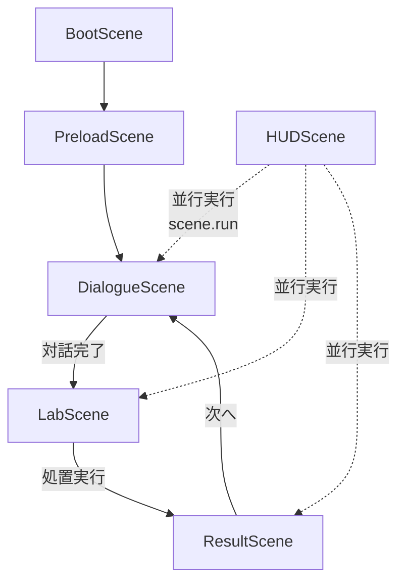

# Project: FLASK — Phaser 3 / Vite / TypeScript ゲームアーキテクチャ

- **ステータス**: Proposed (ADR-0004 に準拠)
- **策定日**: 2026-11-11
- **対象**: Phaser 3 スタンドアロン Web ゲーム
- **前提 ADR**: [ADR-0004](./adr/0004-phaser-game-engine-migration.md)

---

## 1. 目的

Project: FLASK を **Phaser 3 ゲームエンジン** 上で構築する。UI・状態・決定論的化学シミュレーションをブラウザ内で完結させ、外部 API・サーバー依存を持たない。純粋ロジック層（`src/lib/*.ts`）は **Phaser 非依存** のまま維持し、既存テスト資産を継続活用する。

---

## 2. 構成

```text
src/
├── main.ts                 # Phaser.Game ブートエントリーポイント
├── game/
│   ├── Game.ts             # ゲーム設定・シーン登録
│   ├── scenes/
│   │   ├── BootScene.ts       # 設定・スケール初期化
│   │   ├── PreloadScene.ts    # アセット読み込み
│   │   ├── DialogueScene.ts   # 対話フェーズ
│   │   ├── LabScene.ts        # 処置ラボフェーズ
│   │   ├── ResultScene.ts     # 結果表示フェーズ
│   │   └── HUDScene.ts        # 常駐ヘッダー（並行実行: scene.run('HUD')）
│   ├── ui/
│   │   ├── DialogueUI.ts      # 対話表示コンポーネント
│   │   ├── LabUI.ts           # ラボセレクタ（DOM オーバーレイ or Phaser UI）
│   │   ├── ResultUI.ts        # 結果表示コンポーネント
│   │   └── HUDUI.ts           # ヘッダー表示
│   └── state/
│       └── GameState.ts       # シーン間共有ステート（評判/所持金/進行度）
├── lib/                      # 純粋ロジック（変更なし・Phaser 非依存）
│   ├── dialogueEngine.ts     # 対話ノード・状態遷移
│   ├── recipeEngine.ts       # レシピ照合・パラメータ定義
│   ├── reactionEngine.ts     # 酸洗浄反応計算
│   ├── fateEngine.ts         # 因果判定・分岐ロジック
│   └── purityEngine.ts       # 純度計算・設備制約（コア）
└── styles.css                # HUD/DOM オーバーレイ用最小 CSS
```

---

## 3. 依存方向

```
main.ts
  └─ Game.ts
       ├─ scenes/*.ts (Phaser Scene クラス)
       │    ├─ 依存: GameState (共有ステート)
       │    ├─ 依存: lib/*.ts (純粋ロジック) ← **一方向のみ**
       │    └─ 依存: ui/*.ts (表示コンポーネント)
       └─ ui/*.ts
            └─ 依存: lib/*.ts (純粋ロジック)
```

### 依存ルール

- **`src/lib/` は Phaser・React・DOM・外部 API を一切参照しない**（純粋 TypeScript 関数群）
- **シーンクラスは `lib/` の公開 API のみを利用する**
- **UI コンポーネントは Phaser GameObjects（rexUI / 自作）で実装** —— **DOM オーバーレイ不使用、Canvas 完結**
- **タッチファースト設計**: 全インタラクションがタッチ/クリックのみで完結（ホバー依存なし、最小タッチターゲット 48×48dp）
- **レスポンシブスケール**: `Phaser.Scale.FIT` + `autoCenter` で画面サイズに追従、安全領域（Safe Area）考慮
- **シーン間データ受け渡し**: `scene.start('NextScene', { gameState })` パターン
- **永続ステート**: `GameState` クラスで管理（評判/所持金/エピソード進行/解放済みレシピ等）

---

## 4. シーン遷移フロー



### シーン遷移データ

| 遷移 | 受け渡しデータ (`scene.start('Scene', data)`) |
|------|----------------------------------------------|
| Dialogue → Lab | `{ gameState, recipeId: 'EP01', unlockedTags }` |
| Lab → Result | `{ gameState, attempt, reactionResult, fateOutcome }` |
| Result → Dialogue | `{ gameState, nextEpisodeId }` |

---

## 5. 要求追跡

| 要求ID | 受け入れテスト | 実装 |
|--------|----------------|------|
| REQ-CHEM-01〜04 | `tests/purity-engine.test.ts` | `src/lib/purityEngine.ts` |
| REQ-TALK-01 | `tests/dialogue-engine.test.ts` | `src/lib/dialogueEngine.ts` + `DialogueScene` |
| REQ-FATE-01〜04 | `tests/fate-engine.test.ts` | `src/lib/fateEngine.ts` + `ResultScene` |
| REQ-ATOM-01〜04 | `tests/recipe-engine.test.ts` | `src/lib/recipeEngine.ts` + `LabScene` |
| REQ-LAB-01〜04 | `tests/purity-engine.test.ts` | `src/lib/purityEngine.ts` + `GameState` |
| NFR-PERF-01 | `tests/reaction-engine.test.ts` | `src/lib/reactionEngine.ts` |
| NFR-REPR-01 | `tests/purity-engine.test.ts` | `src/lib/purityEngine.ts` |
| NFR-INTEG-01 | `tests/fate-engine.test.ts` | `src/lib/fateEngine.ts` |
| NFR-GRAPH-01 | `tests/recipe-engine.test.ts` | `src/lib/recipeEngine.ts` |
| NFR-CONFIG-01 | `tests/purity-engine.test.ts` | `src/lib/purityEngine.ts` |
| NFR-NARR-01 | `tests/dialogue-engine.test.ts` | `src/lib/dialogueEngine.ts` |

---

## 6. UI 実装方針：全 UI を Phaser Canvas 内で完結（rexUI / 自作 GameObjects）

### 方針
- **DOM オーバーレイ不使用** —— `<div id="ui-overlay">` 等の HTML 要素を一切使わない
- **rexUI プラグイン採用** —— Phaser 公式 UI ライブラリ（`phaser3-rex-plugins`）でボタン・スライダー・パネル・スクロールビュー等を構築
- **自作 GameObjects で補完** —— 特殊な表示（プレビューパネルのゲージ、等級バッジ等）は `Graphics` / `Text` / `Container` で自作

### タッチファースト要件
| 要件 | 実装 |
|------|------|
| **最小タッチターゲット** | 48×48 dp 以上（rexUI `Button` の `space` / `width`/`height` で確保） |
| **ホバー非依存** | `:hover` 疑似クラス不使用。押下時のみ `setAlpha(0.7)` 等の視覚フィードバック |
| **スクロール/ドラッグ** | `rexUI.Sizer` + `rexUI.Scroller` でタッチスクロール対応 |
| **安全領域** | `scale.outerBounds` / `scale.gameSize` からノッチ・ホームバーを避けるマージン確保 |
| **画面回転** | `Phaser.Scale.RESIZE` モードでリサイズ時に `scene.scale.on('resize')` で UI 再レイアウト |

### LabScene 具体構成（rexUI）
```typescript
// セレクタグリッド: rexUI.GridSizer で 4列 × 3行のボタンマトリクス
const grid = scene.rexUI.add.gridSizer({ column: 4, row: 3, space: { left: 8, right: 8, top: 8, bottom: 8 } })
  .add(buttonFactory('acid', 'HCl'), 0, 0, 'center', 0, true)
  .add(buttonFactory('acid', 'Citric'), 1, 0, 'center', 0, true)
  // ...

// プレビューパネル: rexUI.Sizer で縦積み（等級バッジ + 詳細数値）
const preview = scene.rexUI.add.sizer({ orientation: 'y', space: { item: 6 } })
  .add(gradeBadge)
  .add(matchScoreText)
  .add(detailPanel)

// 実行ボタン: 大型ボタン（最小 120×56dp）
const executeBtn = scene.rexUI.add.roundRectangle(0, 0, 160, 64, 12, 0x2d6a4f)
  .setInteractive()
  .on('pointerdown', onExecute)
```

### 共通 UI ファクトリ（`src/game/ui/common/UIFactory.ts`）
```typescript
export const createTouchButton = (scene, text, onClick, options = {}) => 
  scene.rexUI.add.label({
    background: scene.rexUI.add.roundRectangle(0, 0, 0, 0, 10, 0x3d4a5c),
    text: scene.add.text(0, 0, text, { fontSize: '18px', color: '#fff' }),
    space: { left: 16, right: 16, top: 10, bottom: 10, icon: 8 },
    ...options
  })
  .setInteractive()
  .on('pointerdown', onClick)
  .on('pointerover', () => {}) // ホバー無効化
  .on('pointerout', () => {})
```

### アセット不要・ベクター描画優先
- ボタン・パネル・ゲージは `Graphics` / `RoundRectangle` でベクター描画（解像度非依存）
- アイコンは `Text` で絵文字/Unicode（🧪 ⚗️ 🔬 ⚠️ ✨）またはシンプルな SVG を `Texture` 化して使用

---

## 7. スケール・セーフエリア設定（`Game.ts`）

---

## 7. スケール・セーフエリア設定（`Game.ts`）

```typescript
const config: Phaser.Types.Core.GameConfig = {
  type: Phaser.AUTO,
  width: 1280,
  height: 720,
  parent: 'game',
  scale: {
    mode: Phaser.Scale.FIT,
    autoCenter: Phaser.Scale.CENTER_BOTH,
    min: { width: 320, height: 180 },
    max: { width: 1920, height: 1080 },
  },
  dom: { createContainer: false }, // DOM コンテナ無効化（Canvas 完結）
  plugins: {
    scene: [
      { key: 'rexUI', plugin: require('phaser3-rex-plugins/templates/ui/ui-plugin.js'), mapping: 'rexUI' },
    ],
  },
  // ...
}
```

### セーフエリアマージン（`BootScene` で計算・全シーン共有）
```typescript
const safeMargin = {
  top: Math.max(0, window.innerHeight * 0.05),     // ノッチ/ステータスバー
  bottom: Math.max(0, window.innerHeight * 0.08),  // ホームバー/ジェスチャー領域
  left: Math.max(0, window.innerWidth * 0.02),
  right: Math.max(0, window.innerWidth * 0.02),
}
GameState.safeArea = safeMargin // 全 UI 配置でこのマージン内に収める
```

---

## 8. 実行

```bash
npm install phaser phaser3-rex-plugins   # rexUI 追加
npm run dev              # Vite + Phaser 開発サーバー
npm test                 # 純粋ロジックテスト（Vitest）継続
npm run build            # 単一 index.html + アセットバンドル
npm run lint             # ESLint + TypeScript チェック
```

---

## 9. 制約

- 既存の Python/Flask 実装と API 契約を使用しない
- Vite の開発サーバーとビルド済み静的資産だけでアプリを実行する
- **純粋ロジック（`src/lib/`）の決定論性・テスト完全性を最優先で守る**
- Phaser 固有コード（Scene/GameObjects）は `src/game/` 以下に隔離
- **DOM オーバーレイ禁止** —— 全 UI は Canvas 内（`dom: { createContainer: false }`）
- **タッチファースト** —— ホバー前提 UI 不可、最小タッチターゲット 48×48dp、セーフエリア遵守
- **外部アセット最小化** —— ベクター描画・絵文字・プロシージャル生成優先、画像アセットは将来差し替え