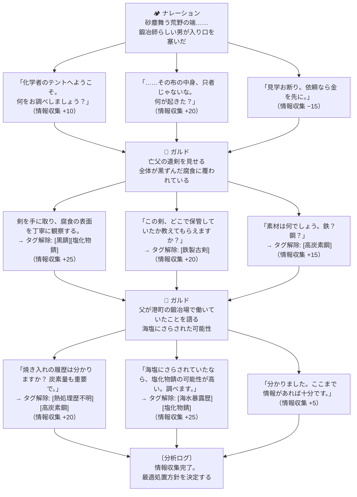

# エピソード1「古剣の腐食」— シナリオ詳細

- **エピソードID**: EP-01
- **状態**: 実装済み
- **対応ファイル**:
  - [`src/lib/dialogueEngine.ts`](../../src/lib/dialogueEngine.ts)
  - [`src/lib/reactionEngine.ts`](../../src/lib/reactionEngine.ts)
  - [`src/lib/fateEngine.ts`](../../src/lib/fateEngine.ts)

---

## あらすじ

砂塵舞う荒野の端、旅の化学者のテントに夕刻、鍛冶師の男が現れた。  
布に包んだ長剣を抱えたその男の名はガルド。  
亡き父が遺した剣が謎の腐食に覆われており、どんな鍛冶師も手が出せないという。  
化学者として腐食の正体を分析し、適切な酸洗浄処置で剣を蘇らせることができるか——。

**テーマ:** *「正確な分析こそが、正しい処置への道である」*

---

## フェーズ構成

```
フェーズ1: 問診（対話）
  └─ 依頼人から情報を引き出し、腐食の種類を特定する

フェーズ2: 実験台（化学処置）
  └─ 酸の種類・濃度・温度を選択して修復スコアを算出する

フェーズ3: 結果（因果判定）
  └─ 修復スコアと副産物フラグから5種類の結末が分岐する
```

---

## フェーズ1: 対話フロー

### 会話ツリー



### 分析タグと推奨処置の導出ルール

| 取得タグの組み合わせ | 推奨処置 | 理由 |
|-------------------|---------|------|
| `[黒錆]` + `[塩化物錆]` | **リン酸 (H₃PO₄)** | 塩化物錆に HCl を使うと塩素が増加して悪化する。リン酸が安全 |
| `[塩化物錆]` のみ | **クエン酸** | 穏やかで塩化物に対応できる |
| `[黒錆]` のみ | **塩酸 (HCl)** | 黒錆（Fe₃O₄）に対しては速効性がある |
| タグなし | 不明（プレイヤー任意） | 情報不足の場合は自力で選択する |

---

## フェーズ2: 実験台パラメータ

### 操作変数

| 変数 | 範囲 | 説明 |
|------|------|------|
| **酸の種類** | 塩酸 / クエン酸 / リン酸 | 腐食の種類との相性が重要 |
| **濃度レベル** | Lv.1〜5 | 薄いと効かない、濃すぎると金属を侵食 |
| **処置温度** | 15〜60℃ | 低すぎると反応が遅い、高すぎると危険 |

### 各酸の最適条件（正解）

| 酸 | 最適濃度 | 最適温度 | 腐食除去力 | 注意点 |
|----|---------|---------|-----------|-------|
| 塩酸 (HCl) | Lv.2〜3 | 20〜35℃ | 0.85 | 高濃度+高温で HCl ガス発生（事故）|
| クエン酸 | Lv.3〜5 | 40〜55℃ | 0.70 | 穏やかだが条件が厳しめ |
| リン酸 | Lv.3〜4 | 35〜45℃ | 1.00 | 最もバランスが良い（推奨） |

### 修復スコアの計算式

```
修復スコア = 錆除去率 − 金属侵食率

錆除去率 = 腐食除去力 × 濃度適正係数 × 温度適正係数 × 100
金属侵食率 = max(0, 超過濃度×8 + 超過温度×1.2) × 酸ペナルティ
酸ペナルティ = HCl: 1.4 / その他: 1.0

有害ガス発生条件: HCl かつ 濃度≥4 かつ 温度≥45℃
```

---

## フェーズ3: 結末分岐

| 条件 | 結末 | 評判 | 報酬 | 口コミ |
|------|------|------|------|-------|
| HCl 高濃度+高温（ガス発生） | 💥 **事故発生**（塩化水素ガス漏出） | −40 | 0G | 安全管理失態として近隣に広まる |
| スコア ≥ 80 | ✨ **完全修復**（神業の腐食除去） | +35 | 280G | 鍛冶師組合に紹介される |
| スコア 55〜79 | 🗡️ **良好な修復** | +18 | 160G | 信頼できる技術者として口コミ |
| スコア 25〜54 | ⚠️ **修復不完全**（腐食残存） | +3 | 60G | なし |
| スコア < 25 | 💀 **失敗**（金属侵食） | −30 | 0G | 鍛冶師組合から警告 |

### 完全修復時のシーン（スコア 80+）

> 酸洗浄液が静かに腐食を溶かしていく。  
> 数十分後、黒い膜が完全に剥がれ落ち、鋼の輝きが蘇った。  
> ガルドは剣を光にかざし、しばらく言葉を失っていた。  
> 「……親父の顔が、刃に映っている。ありがとう。」  
> 鍛冶師の目に、光るものが見えた。

---

## 今後の伏線

- ガルドの父親が「なぜ古剣を持っていたか」は意図的に未解決のままにしている
- 評判が上がると Ep.2 以降でガルドからの紹介依頼が入る（実装予定）
- 剣の来歴が Ep.5〜7 の物語と繋がる可能性を残している

